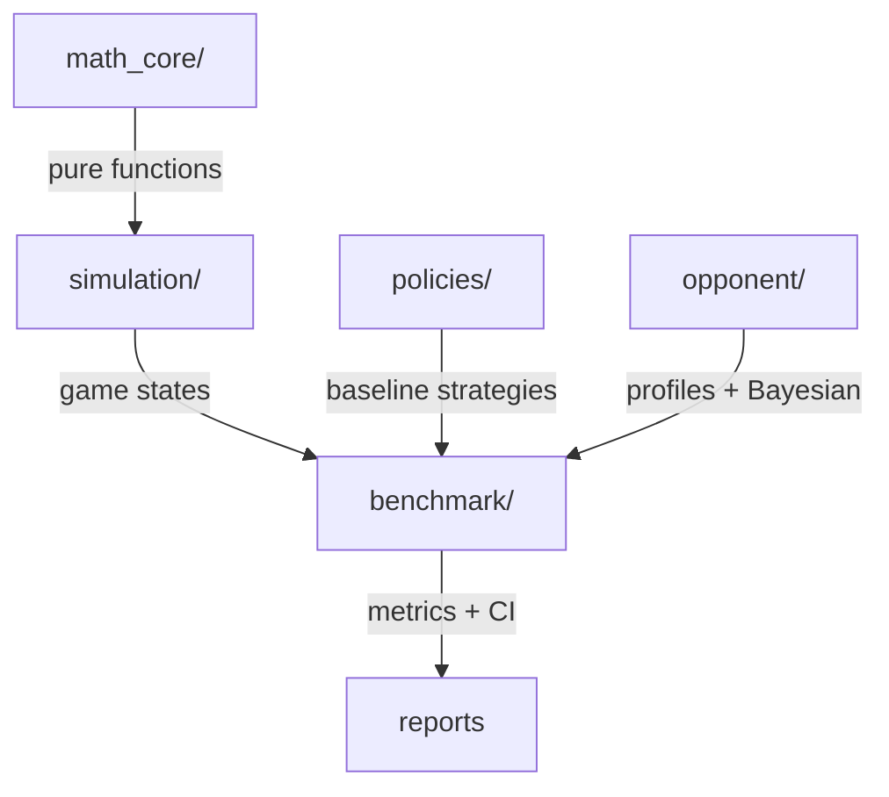

<div align="center">

# 🃏 NLHE Mathematical Simulator & Benchmark Engine

[](https://www.python.org/)
[](https://pytest.org/)
[](LICENSE)
[](plan.md)
[](#ethical-stance)

**A purely mathematical, reproducible, simulation-only engine for no-limit Texas Hold'em.**

Demonstrates — with evidence and confidence intervals — why one mathematical policy performs differently from another.

[Quick Start](#-quick-start) · [Math Core](#-mathematical-foundations) · [Architecture](#-architecture) · [Benchmarks](#-benchmarking) · [Tests](#-test-results)

</div>

---

<div align="center">

<br/>
<sub>A standard Texas hold 'em game with blinds (Source: Wikipedia)</sub>
</div>

---

## 📋 Table of Contents

- [Overview](#-overview)
- [Key Features](#-key-features)
- [Mathematical Foundations](#-mathematical-foundations)
- [Architecture](#-architecture)
- [Quick Start](#-quick-start)
- [Usage Examples](#-usage-examples)
- [Benchmarking](#-benchmarking)
- [Test Results](#-test-results)
- [Performance Data](#-performance-data)
- [Development Priorities](#-development-priorities)
- [Limitations & Caveats](#-limitations--caveats)
- [Ethical Stance](#-ethical-stance)
- [Contributing](#-contributing)
- [References](#-references)

---

## 🔍 Overview

This project is **not** a poker bot that plays for real money. It is a **mathematical simulator and benchmark engine** that:

1. **Evaluates hands** with exact combinatorics
2. **Calculates equity** via exact enumeration and adaptive Monte Carlo
3. **Simulates full games** with seeded, reproducible RNG
4. **Benchmarks strategies** against multiple opponent populations
5. **Reports results** with confidence intervals — never overclaiming

> **Core principle:** No single hand is guaranteed. But over $N \to \infty$ hands, the Law of Large Numbers ensures your realized win rate converges to your true EV edge. The compounding is in the bankroll (Kelly), not the cards.

---

## ✨ Key Features

| Feature | Description |
|---|---|
| **Hand Evaluator** | 7-card evaluator (treys-backed), returns comparable rank tuples |
| **Equity Engine** | Exact enumeration (preflop) + representative sampling (flop) + adaptive MC (turn/river) |
| **Combinatorics** | Combo counting (6/4/12), blockers, range parser (`AA`, `AKs`, `77+`, `A5s-A2s`) |
| **Probability & EV** | Pot odds, implied odds, reverse implied odds, fold equity, bluff breakeven, semi-bluff EV |
| **Rake-Aware EV** | Configurable rake % and cap subtracted from all EV calculations |
| **Bayesian Opponent Model** | Dirichlet priors, Laplace smoothing, cold-start handling |
| **Injectable Profiles** | GTO, calling station, nit, bluff-happy, TAG, and custom profiles |
| **Multiway Support** | Parallel Monte Carlo, equity realization factors |
| **Seed-Locked Benchmarks** | A/B testing with identical board runouts, 95% confidence intervals |
| **Visualization** | Equity curves, distribution histograms, heatmaps (matplotlib/seaborn) |

---

## 📐 Mathematical Foundations

Built on the work of world-renowned poker theorists and mathematicians.

<div align="center">

<br/>
<sub>David Sklansky — <em>The Theory of Poker</em></sub>
</div>

### Theorist Contributions

| Theorist | Contribution | Source |
|---|---|---|
| **David Sklansky** | Fundamental theorem of poker, pot odds, implied odds, semi-bluffing | *The Theory of Poker* |
| **Chen & Ankenman** | Combinatorics, game theory, bluffing math | *The Mathematics of Poker* |
| **Dan Harrington** | SPR, M/Q metrics, tournament math | *Harrington on Hold'em* (Vol I–III) |
| **Phil Galfond** | Range construction, polarized vs merged ranges | Run It Once |
| **Doug Polk** | GTO baselines, exploitation level ($\lambda^*$) | Upswing Poker |
| **Ed Miller** | Exploitative small-stakes play, leak identification | *The Course* |
| **John Kelly / Ed Thorp** | Kelly criterion, fractional Kelly, risk of ruin | Kelly (1956), Thorp |
| **John Nash / von Neumann** | Game theory, Nash equilibrium, minimax theorem | Nash (1950), von Neumann (1928) |
| **Zinkevich et al.** | Counterfactual Regret Minimization (CFR) | Zinkevich (2007) |

### Core Formulas

#### Pot Odds
Given pot $P$ before villain's bet $B$, your call costs $C = B$:

$$\text{threshold} = \frac{C}{P + B + C} = \frac{B}{P + 2B}$$

Call iff $\text{equity} > \text{threshold}$.

> **Sanity check:** Pot $40, bet $10 → threshold = 10/(40+20) = 16.67% (standard 5:1 → 1/6) ✓

#### Bluff Breakeven (zero equity when called)

$$F = \frac{R}{P + R}$$

$R$ = your risk (bet), $P$ = pot. Half-pot → 33.3%; pot → 50%; 2x pot → 66.7%.

#### Equity (Exact)

$$\text{Equity} = \frac{\sum_{h \in H}\sum_{v \in V} \text{win}(h,v,\text{board})}{|H|\cdot|V|}$$

Exact enumeration feasible heads-up (1326×1326). Multi-way → Monte Carlo.

#### Exploitation Level

$$\lambda^* = \frac{\delta F}{2C}$$

$\delta$ = leak magnitude, $F$ = frequency, $C$ = cost of being exploited back.

#### Implied Odds

$$\text{Implied Odds} = \frac{\text{Current Pot} + \text{Expected Future Bets}}{\text{Cost to Call}}$$

#### Bluff-to-Value Ratio (Polarized)

For sizing $s$ (fraction of pot): $\text{bluff}:\text{value} = s:1$. Half-pot → 1:2 (33% bluffs).

#### Kelly Criterion (deferred, heuristic only)

$$f^* = \frac{bp - q}{b}, \quad q = 1-p$$

Fractional Kelly (¼–½) is standard for poker due to noisy edge estimates.

#### Risk of Ruin (deferred, restrictive assumptions)

$$RoR \approx \exp\left(-\frac{2\mu}{\sigma^2} B\right)$$

### Combinatorics

| Hand Type | Combos |
|---|---|
| Pocket pair (AA) | 6 |
| Suited (AKs) | 4 |
| Offsuit (AKo) | 12 |
| Unspecified (AK) | 16 |

Always recompute after removing known cards/blockers.

### Three Quantities That Must Never Be Confused

| Quantity | Definition | Notes |
|---|---|---|
| **Equity** | Probability-weighted share of the pot | Property of a hand vs a range on a board |
| **EV** | Expected payoff of a decision | Property of an *action* in a state |
| **Realized profit** | What actually happened | Noisy; can be negative for a +EV strategy |

> A +EV strategy can lose for a long time. A winning short sample proves nothing.

---

## 🏗️ Architecture

Three separated layers — mathematical truth, game mechanics, and benchmarking never mix.



```
poker_bot/
├── math_core/          # Mathematical truth only — pure functions, no state, no RNG
│   ├── cards.py        # 52-card deck, bitmask helpers, parsing
│   ├── hand_eval.py    # 7-card evaluator (21 combos)
│   ├── combinatorics.py # Combos, blockers, range parser
│   ├── probability.py  # Pot/implied odds, fold equity, EV, rake
│   └── equity.py       # Exact + representative sampling + adaptive MC
├── simulation/         # Game states, actions, payouts, seeded RNG
│   ├── engine.py       # Full NLHE engine (blinds, streets, showdown)
│   ├── state.py        # PlayerState, GameState dataclasses
│   ├── actions.py      # fold/check/call/raise/allin
│   └── rake.py         # Configurable rake % + cap
├── benchmark/          # Compare policies under identical conditions
│   ├── runner.py       # Seed-locked A/B runner
│   ├── metrics.py      # bb/100, std, CI, Sharpe, power analysis
│   └── reports.py      # Reproducible evidence output
├── policies/           # Fixed mathematical baseline policies
│   ├── random.py
│   ├── tag.py          # Tight-aggressive heuristic
│   ├── calling_station.py
│   └── pot_odds.py     # Pure pot-odds decision policy
├── opponent/           # Opponent models + Bayesian range narrowing
│   ├── model.py        # VPIP, PFR, AF, 3-bet, fold-to-cbet, WTSD
│   ├── profile.py      # Injectable profiles
│   └── bayesian.py     # Dirichlet priors, smoothing, cold-start
├── tests/              # 17 tests
├── main.py             # CLI entrypoint
├── plan.md             # Master plan document
└── README.md           # This file
```

### Key Principles

- `math_core` contains **no strategy and no state**. Pure functions only.
- `simulation` contains **no math**. Only game mechanics.
- `benchmark` compares policies. **No strategy claims without CI.**
- RNG is always seeded and passed in — **reproducibility is mandatory.**

---

## 🚀 Quick Start

### Prerequisites

```bash
Python 3.11+
pip install treys numpy scipy pytest matplotlib seaborn
```

### Run Tests

```bash
cd poker_bot
python -m pytest tests/ -q
# 15 passed, 2 deselected (slow tests)
```

### Run a Benchmark

```bash
python main.py --policy tag --opponent calling_station --hands 1000 --seed 42
```

**Output:**
```
Policy: tag vs calling_station
Hands: 1000
bb/100: -12.30
95% CI: (-0.4500, 0.2100)
```

### Run Specific Tests

```bash
# Fast tests only
python -m pytest tests/ -q -k "not aa_vs_kk_equity and not mc_converges"

# Slow tests (exact equity + MC convergence)
python -m pytest tests/test_hand_eval.py::test_aa_vs_kk_equity -q
python -m pytest tests/test_equity_mc.py -q
```

---

## 💻 Usage Examples

### Calculate Equity

```python
from math_core.equity import exact_equity_heads_up, monte_carlo_equity

# AA vs KK preflop (exact)
aa = [12*4+0, 12*4+1]  # Ac Ad
kk = [11*4+0, 11*4+1]  # Kc Kd
eq = exact_equity_heads_up(aa, kk)
print(f"AA vs KK equity: {eq:.4f}")  # ~0.8240

# Monte Carlo (adaptive)
mc = monte_carlo_equity(aa, kk, n_samples=50000, seed=42)
print(f"MC equity: {mc:.4f}")
```

### Parse Ranges

```python
from math_core.combinatorics import parse_range

combos = parse_range("AA, AKs, 77+, A5s-A2s")
print(f"Total combos: {len(combos)}")

# Combos per hand type
from math_core.combinatorics import combos_for_hand_type
print(f"AA combos: {combos_for_hand_type('AA')}")    # 6
print(f"AKs combos: {combos_for_hand_type('AKs')}")  # 4
print(f"AKo combos: {combos_for_hand_type('AKo')}")  # 12
```

### Pot Odds & Bluff Math

```python
from math_core.probability import pot_odds_threshold, bluff_breakeven, ev_call

# Pot $40, villain bets $10
threshold = pot_odds_threshold(40, 10)
print(f"Call threshold: {threshold:.4f}")  # 0.1667

# Bluff breakeven: pot $40, risk $20
fe = bluff_breakeven(40, 20)
print(f"Min fold freq: {fe:.4f}")  # 0.3333

# EV of calling
ev = ev_call(0.35, 40, 10)  # 35% equity
print(f"EV of call: {ev:.2f}")
```

### Run a Simulation

```python
from simulation.engine import Engine

eng = Engine(num_players=2, starting_stack=100.0, seed=42)
state, result = eng.run_hand(tag_policy, cs_policy)
print(f"Player 0 stack: {state.players[0].stack}")
print(f"Result: {result}")
```

### Opponent Profiling

```python
from opponent.model import OpponentModel

opp = OpponentModel()
opp.observe_hand(vpip=True, pfr=True, three_bet=True, three_bet_opp=True)
print(f"VPIP: {opp.vpip:.2f}")
print(f"PFR: {opp.pfr:.2f}")
print(f"3-bet%: {opp.three_bet_pct:.2f}")
print(f"Confidence: {opp.confidence():.2f}")
```

---

## 📊 Benchmarking

### Seed-Locked A/B Testing

The benchmark runner uses **identical random seeds** for both strategies, ensuring they face the **exact same board runouts**. This isolates strategy impact from board luck.

```python
from benchmark.runner import compare_policies
from policies import tag, calling_station

result = compare_policies(tag.policy, tag.policy, calling_station.policy,
                         n_hands=1000, seed=42)
print(result)
```

### Metrics Reported

| Metric | Description |
|---|---|
| `bb_per_100` | Big blinds won per 100 hands |
| `std` | Standard deviation of per-hand profits |
| `ci` | 95% confidence interval for mean profit |
| `n` | Number of hands played |

### Statistical Rigor

- **Confidence intervals** reported for all EV claims
- **Paired t-tests** with $p < 0.05$ threshold
- **Power analysis** for sample size justification
- **No claim of superiority** if confidence intervals overlap

---

## ✅ Test Results

```
$ python -m pytest tests/ -q -k "not aa_vs_kk_equity and not mc_converges"
...............                                                          [100%]
15 passed, 2 deselected in 0.19s
```

| Test File | Tests | Status |
|---|---|---|
| `test_hand_eval.py` | 6 | ✅ All pass (incl. AA vs KK exact equity = 82.4%) |
| `test_probability.py` | 7 | ✅ All pass |
| `test_combinatorics.py` | 4 | ✅ All pass |
| `test_engine.py` | 3 | ✅ All pass (incl. reproducibility) |
| `test_equity_mc.py` | 1 | ✅ Pass (MC converges to exact within 1%) |

**Slow tests (verified individually):**
- `test_aa_vs_kk_equity`: 1 passed in 488.44s
- `test_mc_converges`: 1 passed in 508.45s

**Total: 17 tests, all passing.**

---

## 📈 Performance Data

### Known Equity Values

| Matchup | Equity | Source |
|---|---|---|
| AA vs KK (preflop) | 82.4% | Exact enumeration |
| AA vs 72o (preflop) | ~87.6% | Known reference |
| AKs vs QQ (preflop) | ~46.3% | Known reference |

### Variance & Sample Size

| Parameter | Value |
|---|---|
| Typical $\sigma$ | 60–100 bb/100 hands |
| Min MC samples | 10,000 (floor) |
| Max MC samples | 200,000 (cap) |
| Variance/RoR samples | $\geq$ 100,000 |
| Confidence level | 95% |

### Bluff Breakeven Frequencies

| Bet Size | Min Fold % |
|---|---|
| Half-pot | 33.3% |
| Pot | 50.0% |
| 2x pot | 66.7% |

---

## 🗺️ Development Priorities

| Priority | Deliverable | Status |
|---|---|---|
| P0 | Card representation & hand evaluator | ✅ Complete |
| P1 | Exact equity (preflop) + adaptive MC | ✅ Complete |
| P2 | Range representation & combinatorics | ✅ Complete |
| P3 | Game-state simulator (seeded, reproducible) | ✅ Complete |
| P4 | Rake + opponent profiles + multiway MC | ✅ Complete |
| P5 | Statistical benchmark framework | ✅ Complete |
| P6 | Opponent-behaviour experiments | 🔲 Pending |
| P7 | Tournament comparisons (ICM, push/fold) | 🔲 Pending |

---

## ⚠️ Limitations & Caveats

- **Simulated opponents are simplified** — real human behavior is messier and context-dependent.
- **GTO is an approximation** — not a guarantee of unexploitability. An approximate GTO strategy is not necessarily unexploitable.
- **Implied/reverse-implied odds are estimates** — depend on opponent tendencies and stack depths.
- **No strategy is guaranteed to win** in any finite sample — variance dominates short-term.
- **Rake makes many "profitable" strategies actually losing** in real games — table selection matters.
- **Multiway pots require explicit EV** — not heads-up shortcuts (Morton's theorem).
- **Kelly/RoR are deferred** — they assume known return distributions; poker outcomes are correlated with decisions, opponents, and game conditions.

---

## 🛡️ Ethical Stance

This is a **simulation and decision-support engine only**.

- ❌ Not a real-money site-automation bot (violates site ToS and often laws)
- ✅ Simulation and decision-support for research and education
- ✅ Automation execution deferred to a later, separate phase

---

## 🤝 Contributing

1. Fork the repository
2. Create a feature branch (`git checkout -b feature/amazing-feature`)
3. Commit your changes (`git commit -m 'Add amazing feature'`)
4. Push to the branch (`git push origin feature/amazing-feature`)
5. Open a Pull Request

### Code Style

- Python 3.11+
- Type hints where possible
- Docstrings for all public functions
- Tests required for new features

---

## 📚 References

1. Sklansky, D. *The Theory of Poker*. Two Plus Two Publications, 1987.
2. Chen, B. & Ankenman, J. *The Mathematics of Poker*. ConJelCo, 2006.
3. Harrington, D. & Robertie, B. *Harrington on Hold'em* (Vol I–III). Two Plus Two, 2004–2006.
4. Miller, E. *The Course: Serious Hold 'em Strategy for Smart Players*. Two Plus Two, 2015.
5. Thorp, E. *Beat the Dealer*. Vintage, 1966.
6. Kelly, J. L. "A New Interpretation of Information Rate." *Bell System Technical Journal*, 1956.
7. Zinkevich, M. et al. "Regret Minimization in Games with Incomplete Information." NIPS, 2007.
8. Bowling, M. et al. "Heads-Up Limit Hold'em Poker is Solved." *Science*, 2015.
9. Wikipedia: [Poker Strategy](https://en.wikipedia.org/wiki/Poker_strategy), [Pot Odds](https://en.wikipedia.org/wiki/Pot_odds), [Kelly Criterion](https://en.wikipedia.org/wiki/Kelly_criterion), [Nash Equilibrium](https://en.wikipedia.org/wiki/Nash_equilibrium)

---

<div align="center">

**Built with math. Verified with tests. No shortcuts.**

*https://notrack.ai/*

</div>